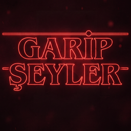

<p align="center"></p>

# Garip Şeyler MC

Stranger Things temalı bir Minecraft Java modu: Nether kırmızı **Ters Dünya**'ya, End **En Derin Dünya**'ya dönüşür; Demogorgon, Demodog, Demobat, Vecna ve Mind Flayer gelir.

> Durum: **Tamamlandı — sürüm 0.1.0** (Faz 0–9). Özellikler aşağıda; geliştirme fazları için bkz. [ROADMAP.md](ROADMAP.md).

**Kısaca:** kırmızı Ters Dünya (Nether) ve kırmızı şimşekler · Demogorgon, Demodog, Demobat görünümleri · portallarda can emen sarmaşıklar · dikit renkli En Derin Dünya (End) · tek seferlik boss **Vecna** · Ender Dragon yerine kulelerden uzun **Mind Flayer** · **Telekinezi Eldiveni** · Alevden Çehre ile Ters Dünya yaratıklarına 2×/4× hasar · başlık ekranında neon logo.

## Gereksinimler
| | Sürüm |
|---|---|
| Minecraft Java | 26.2 |
| Fabric Loader | 0.19.5+ |
| Fabric API | 0.161.0+26.2 |
| GeckoLib | 5.5.5+ (Fabric 26.2) |
| Java | 25 |

## Kurulum (oyuncu)
1. Minecraft 26.2 için Fabric Loader kur.
2. `mods` klasörüne **Fabric API**, **GeckoLib** (Fabric 26.2, [Modrinth](https://modrinth.com/mod/geckolib)) ve `garipseylermc-<sürüm>.jar` dosyasını koy.
3. Oyunu Fabric profiliyle başlat. Başlık ekranında neon "Garip Şeyler" logosu görünüyorsa mod yüklenmiştir.

**Çok oyunculu:** sunucuda da aynı üç dosya gerekir; oyuncuların da modu kurması gerekir (yeni mob/blok/eşyalar ve görünümler istemcide çizilir).
**Mevcut dünyalar:** mod eski dünyalarda çalışır. End kuleleri yalnızca yeni üretilen End'de Ters Dünya Taşı olur; yaşayan bir ejderha varsa yerine Mind Flayer gelir.

## Geliştirme
```bat
gradlew build        :: jar -> build/libs/
gradlew runClient    :: geliştirme istemcisi
gradlew runServer    :: geliştirme sunucusu (run/ klasörü)
run.bat              :: derle + MehburMC "Garip Şeyler Test" profiline kopyala + launcher'ı aç
```

## Proje yapısı
```
src/main/java/dev/mehbur/garipseyler/      ortak (sunucu + istemci)
├── config/     ModConfig, ConfigManager
├── command/    /garipseyler komutları
├── dimension/  Ters Dünya / En Derin Dünya mantığı
├── entity/     Vecna, Mind Flayer
├── block/      Ters Dünya Taşı, sarmaşık
├── item/       Telekinezi Eldiveni
├── effect/     Vecna Laneti, efekt yardımcıları
└── network/    sunucu → istemci paketleri
src/client/java/dev/mehbur/garipseyler/client/   sadece istemci
├── render/  sky/  hud/  input/
```

## Ayarlar
İlk açılışta `config/garipseylermc.json` oluşur. Değiştirdikten sonra oyunu yeniden başlat ya da `/garipseyler reload` yaz (OP gerekir). Hatalı JSON yazılırsa dosya `.broken` olarak yedeklenir ve varsayılanlar kullanılır.

| Bölüm | Anahtar | Varsayılan | Açıklama |
|---|---|---|---|
| `menu` | `titleScreenLogo` | `true` | Başlık ekranında Minecraft logosu yerine neon "Garip Şeyler" logosu ² |
| `nether` | `titleOnEnter` | `true` | Girişte "Ters Dünya" başlığı |
| | `fogColor` | `"#3d0a0d"` | Ters Dünya sis rengi ¹ |
| | `ambientLightColor` | `"#3a1414"` | Ortam ışığı tonu ¹ |
| | `fogStartDistance` / `fogEndDistance` | `4.0` / `72.0` | Sis başlangıç/bitiş mesafesi ¹ |
| | `sporeProbability` | `0.03` | Spor partikülü yoğunluğu (0–1) ¹ |
| | `redLightningEnabled` | `true` | Kırmızı şimşek açık/kapalı |
| | `redLightningIntervalSeconds` | `7` | Şimşek aralığı (sn) |
| | `redLightningMinDistance` / `redLightningMaxDistance` | `16` / `48` | Oyuncudan yatay çakma mesafesi (blok) |
| | `redLightningSound` | `true` | Gök gürültüsü sesi ² |
| | `redLightningFlash` / `redLightningFlashIntensity` | `true` / `0.35` | Kırmızı ekran flaşı ve en yüksek opaklığı (0–1) ² |
| `end` | `titleOnEnter` | `true` | Girişte "En Derin Dünya" başlığı |
| | `fogColor` / `ambientLightColor` / `skyLightColor` | `"#14070a"` / `"#3a1f22"` / `"#8a2a3a"` | En Derin Dünya renkleri ¹ |
| | `ashProbability` | `0.004` | Düşen kül partikülü yoğunluğu ¹ |
| | `upsideDownStoneSpikes` | `true` | Yeni üretilen End kuleleri obsidyen yerine Ters Dünya Taşı'ndan |
| | `dripstoneBlocks` | `true` | End'de End taşı hariç blokları dikit renginde çiz ² ³ |
| | `keepOriginalTexture` | `[]` | End'de kendi dokusunu koruyacak ek bloklar, ör. `["minecraft:torch"]` ² ³ |
| `demogorgon` | `canTeleport` | `false` | Demogorgon (Enderman) ışınlanması. Kapalıyken hiç ışınlanmaz, oklar isabet eder, su/yağmur hasar vermez |
| | `skeletonsShootArrows` | `false` | Demogorgon görünümlü iskeletlerin ok atması. Kapalıyken yay taşısalar da yakın dövüşle saldırırlar |
| `demobat` | `disableOverworldPhantoms` | `true` | Overworld'de uykusuzluk Phantom/Demobat spawn'ını kapatır |
| | `netherOnly` | `true` | Demobat (Phantom + Ghast) yalnızca Nether'da: Overworld/End'e giren veya orada doğan silinir |
| | `netherSpawnWeight` | `10` | Nether biyomlarında doğal spawn ağırlığı (0 = kapalı) ¹ |
| | `netherMinGroup` / `netherMaxGroup` | `1` / `2` | Grup boyutu ¹ |
| `vine` | `growOnLitPortals` / `growOnGeneratedPortals` | `true` / `true` | Oyuncunun yaktığı / oyunun karşı tarafta ürettiği portallarda büyüsün |
| | `coverage` | `0.65` | Çerçevedeki boş obsidyen yüzlerinin sarmaşıkla kaplanma oranı (0–1) |
| | `growthDurationTicks` | `120` | Alttan üste çıkış animasyonunun süresi (tick, 20 = 1 sn) |
| | `drainIntervalMinutes` | `10` | Can düşürme aralığı (dk) |
| | `drainTargetHealth` | `1.0` | Düşürülen can (HP, 2 = 1 kalp) |
| | `effectRadius` | `32` | Etki yarıçapı (blok) |
| | `warningEnabled` / `warningSeconds` | `true` / `30` | Önceden uyarı |
| `vecna` | `maxHealth` | `2000` | Can |
| | `spawnDelayMinutes` | `15` | Nether'da geçen süre sonrası tek seferlik spawn |
| | `gloveDropChance` | `0.001` | Eldiven düşme şansı (%0.1) |
| | `attackDamage` / `armor` | `12` / `10` | Yakın dövüş hasarı, zırh ¹ |
| | `abilityCooldownSeconds` | `6` | İki yetenek arası (2. fazda %70'i) |
| | `curseDamageIntervalSeconds` / `curseDurationSeconds` | `2` / `20` | Lanet: kaç sn'de 1 hasar (havadayken 2 kat hızlı), süre |
| | `levitationSeconds` / `mindControlSeconds` / `vineBindSeconds` | `4` / `3` / `3` | Havada tutma, zihin kontrolü, sarmaşık bağı süreleri |
| | `psychicBlastDamage` | `8` | Psişik patlama hasarı (zorluğa göre ölçeklenir) |
| | `maxMinions` | `6` | Aynı anda en fazla Demodog + Demobat minyonu |
| | `musicProtectionRadius` | `12` | Çalan müzik kutusunun koruma yarıçapı (blok, 0 = kapalı) |
| `mindFlayer` | `replaceEnderDragon` | `true` | End savaşında Ender Dragon yerine Mind Flayer |
| | `maxHealth` | `1500` | Can |
| | `regenDelaySeconds` | `10` | Rejenerasyondan önce hasarsız geçmesi gereken süre |
| | `fullRegenSeconds` | `60` | 0 → tam can süresi (1500 / 60 = 25 can/sn) |
| | `attackDamage` | `110` | Yakın dövüş vuruşu (Demir Golem'i tek vuruşta öldürür) |
| | `armor` | `12` | Zırh |
| | `attackCooldownSeconds` | `4` | İki özel saldırı arası (2. fazda %70'i) |
| | `stompDamage` / `stompRadius` | `20` / `20` | Yere vurma şok dalgası hasarı / yarıçapı |
| | `rockDamage` | `16` | Kaya isabeti (3,5 blok çevreye yarısı) |
| | `roarRadius` / `roarSlownessSeconds` | `40` / `5` | Kükreme yarıçapı / Yavaşlık III süresi |
| | `arenaRadius` | `70` | End merkezinden en fazla uzaklaşma |
| `glove` | `range` | `20` | Yakalama menzili (blok) |
| | `cooldownSeconds` | `5` | Mob fırlatılınca/bırakılınca bekleme |
| | `throwStrength` | `2.0` | Fırlatma hızı (blok/tick) |
| | `maxHoldSeconds` | `15` | En uzun tutma süresi |
| | `impactDamage` | `5.0` | Fırlatılan mob bir yere çarpınca hız başına hasar |

¹ Biyom verisine yazıldığı için dünya/sunucu **yeniden başlatılınca** geçerli olur (`/garipseyler reload` yetmez).
² İstemci ayarı: her oyuncunun kendi `config/garipseylermc.json` dosyasından okunur. Flaş ayrıca vanilla **Erişilebilirlik → "Şimşek Flaşlarını Gizle"** seçeneğine uyar.
³ Doku yüklemede uygulanır: değiştirdikten sonra oyunda **F3+T** (ya da yeniden başlat).
Renkler `#RRGGBB` biçiminde; hatalı renk yazılırsa varsayılan kullanılır.


## Özellikler
Ayrıntılı liste ve durum: [ROADMAP.md](ROADMAP.md).

### Faz 1 — Ters Dünya ve En Derin Dünya ✅
- Nether'ın **tüm biyomları** (Crimson, Warped, Soul Sand Valley, Basalt Deltas, Wastes ve modlu Nether biyomları) tek bir kırmızı Ters Dünya gibi görünür: sis, ortam ışığı, spor partikülleri, ambiyans sesi, fısıltılar, müzik. Arazi, yapılar ve mob spawn'ları değişmez.
- End **En Derin Dünya** olur: kan kırmızısı-siyah gökyüzü, kırmızı ışık tonu, düşen kül, alçak uğultu ambiyansı.
- Boyuta girerken başlık kartı ("Ters Dünya" / "En Derin Dünya"), ilgili başarım adları değişir (TR + EN).

### Faz 2 — Kırmızı şimşek ✅
- Ters Dünya'da her **7 sn**'de bir, her oyuncu grubunun yakınında kırmızı şimşek çakar: mağara zemininden tavana uzanan kırmızı yıldırım, kırmızı ekran flaşı, gök gürültüsü.
- **Tamamen görsel:** şimşek yalnızca istemcide oluşturulur; sunucuda varlık yoktur → hasar, yangın, mob dönüşümü (domuz→piglin vb.) **olamaz**.
- Çok oyunculuda yakındaki herkes aynı şimşeği görür.

### Faz 3 — Mob dönüşümleri ✅
Yalnızca **görünüm** değişir; davranış, can, AI, loot ve vuruş kutuları vanilla kalır (eski dünyalarla uyumlu).

| Vanilla | Görünüm | Ayrım |
|---|---|---|
| Enderman | **Demogorgon** | 5 yapraklı ağız; sinirlenince yapraklar açılır, taşıdığı blok görünür. **Işınlanamaz** (aşağıya bakın) |
| Piglin | **Demodog** | normal boy, koyu |
| Piglin Brute | **Yaralı Demodog** | ×1.15, daha koyu, yara izli |
| Zombified Piglin | **Çürümüş Demodog** | ×0.95, soluk yeşil, et lekeli |
| Hoglin | **Alfa Demodog** | ×1.35, kırmızımsı |
| Zoglin | **Çürümüş Alfa Demodog** | ×1.35, yeşilimsi-kırmızı |
| Phantom | **Demobat** | yarasa kanatlı, yaprak ağızlı |
| Ghast | **Dev Demobat** | ×2.75 Demobat, koyu kırmızı; ateş topu hazırlarken ağzı açılır (Happy Ghast değişmez) |
| Blaze | **Ateş Demobatı** | küçük, kor renkli Demobat, tam aydınlık; ateşlenince ağzı açılır (Faz 8'de eklendi) |
| Skeleton / Stray / Bogged / Parched / Wither Skeleton | **Demogorgon** / **Donmuş** / **Bataklık** / **Kavrulmuş** / **Kara Demogorgon** | Demogorgon modeli, renk varyantları (Kara ×1.2); saldırırken yaprak ağız açılır; ok atmazlar, kovalayıp yakın dövüşle saldırırlar (Faz 8'de eklendi) |

- Bebekler yarım boyda çizilir. Demodog'ların ağız yaprakları saldırırken açılır.
- İsimler, çağırma yumurtaları, ölüm mesajları ve altyazılar yeni adları kullanır (TR + EN). Sesler kendi ses olaylarımıza yönlendirilir.
- **Demogorgonlar ışınlanmaz** (`demogorgon.canTeleport: false`): hasar alınca, suda/güneşte ya da oyuncuya doğru ışınlanmazlar; yürüyerek kovalarlar. Oklardan kaçamadıkları için oklar ve mermiler normal isabet eder (alevli ok yakar); kaçamayacakları için su ve yağmur onlara hasar vermez.
- **Demogorgon iskeletler ok atmaz** (`demogorgon.skeletonsShootArrows: false`): tüm iskelet türleri (Wither Skeleton zaten kılıçlı) oyuncuyu kovalayıp pençeyle vurur. Yay ellerinde kalır (çizilmez), o yüzden yay/ok ganimeti vanilla gibi düşer.
- **Ateşten korkarlar:** Alevden Çehre I'li kılıçla yakın dövüş vuruşu bu yaratıklara (Demogorgon, Demodog, Demobat, Vecna, Mind Flayer) **2 kat**, Alevden Çehre II ile **4 kat** hasar verir (zırhtan önce). Liste `data/garipseylermc/tags/entity_type/upside_down_creatures.json`.
- **Demobat** ve **Dev Demobat** yalnızca Nether'da bulunur: Overworld'deki uykusuzluk spawn'ı kapalıdır; Overworld'e ya da End'e herhangi bir yolla (portal, komut, eski dünya) gelen Phantom/Ghast bir sonraki tick'te silinir. Bu yüzden "Huzursuz İttifak" başarımı alınamaz. Nether tavanı yüzünden takılmasınlar diye, tavanı olan boyutlarda dönme noktaları mağara tavanının altında tutulur.

### Faz 4 — Ters Dünya sarmaşığı ✅
- Görünüm: Stranger Things'teki gibi kalın, etli, parlak damarlı koyu kızıl dokunaçlar (Faz 8'de yenilendi).
- Nether portalı **yakıldığında** ve oyun karşı tarafta **portal ürettiğinde** çerçevenin obsidyenlerine **Ters Dünya Sarmaşığı** büyür.
- Çıkış efekti Warden'ın topraktan çıkışı gibidir: `warden.emerge` sesi çalar, sarmaşıklar alttan üste sırayla filizlenir (filiz → genç → tam), her birinde obsidyen parçacıkları saçılır ve Warden kazma sesi gelir.
- **Lanet:** Nether'da, sarmaşıklı bir portalın `effectRadius` (32) blok yakınında geçirilen her `drainIntervalMinutes` (10) dakikada can `drainTargetHealth`'e (1 HP) iner, emicilik kalpleri silinir, kısa bir karanlık gelir. `warningSeconds` (30) önce ekranda uyarı + saat sesi. Asla öldürmez; yaratıcı/izleyici modu etkilenmez.
- Süre oyuncuya kaydedilir (çıkıp girince sıfırlanmaz, ölünce sıfırlanır); yarıçap dışında durur.
- **Karşı hamle:** sarmaşıklar kırılabilir (hiçbir şey düşürmez). Bir portalın tüm sarmaşıkları kırılınca o portalın laneti kalkar.
- Yönetici komutu: `/garipseyler vine <oyuncu>` → sayaç, sarmaşıklı portal sayısı, en yakın mesafe.

### Faz 5 — Ters Dünya Taşı ve En Derin Dünya renkleri ✅
- **Ters Dünya Taşı** (`garipseylermc:upside_down_stone`): dikit tonunda, obsidyenle aynı dayanıklılık — sertlik 50, patlama direnci 1200, elmas ve üstü kazma gerekir, pistonla itilmez, ejderha kıramaz. Yaratıcı modda *Doğal Bloklar* sekmesinde, ağlayan obsidyenin yanında.
- **End kuleleri** artık bu taştan üretilir (yalnızca **yeni üretilen** End; ejderha yeniden çağrılınca kurulan kuleler de). Eski dünyalardaki kuleler obsidyen kalır.
- **En Derin Dünya'da End taşı hariç her blok dikit renginde görünür** (purpur, End taşı tuğlası, obsidyen, koro bitkisi, End çubuğu, oyuncunun koyduğu bloklar…). Sandıklar ve blok-varlıklı bloklar (varil, fırın, demlik, shulker kutusu, yatak, tabela…) ile çalışma masaları, örsler, kazanlar, ateş ve portal kendi görünüşünü korur.
  - Tamamen **görsel / istemci tarafı**: dünya verisi değişmez, Overworld ve Nether vanilla görünür. Kopyalar oyun açılırken her `textures/block` dokusundan üretilir (kaynak paketleri ve diğer modlar dahil), mod içinde Mojang dokusu yoktur.

### Faz 6 — Vecna ✅
- **Doğuş:** her oyuncunun Nether'da geçirdiği süre sayılır (oyuncuya kaydedilir). Biri `spawnDelayMinutes` (15 dk) dolduğunda Vecna 10–18 blok yakınında doğar: saat çalar, karanlık çöker. **Her dünyada yalnızca 1 kez** (bayrak dünya kaydında). Çağırma yumurtası yok, `/summon` reddedilir, Nether'dan çıkamaz (portal kullanmaz), **despawn olmaz** (Barışçıl'da bile).
- **2000 can** (vanilla'nın 1024 can sınırı mod tarafından yükseltilir), 10 zırh, geri tepmeye bağışık, ateşe/düşmeye dayanıklı. Boss bar **mor**; can %50'nin altına inince **kırmızı** olur (2. faz: "Vecna'nın öfkesi uyanıyor!").
- **Yetenekler** (birkaç saniyede bir, rastgele, her birinin kendi bekleme süresi var):
  1. **Lanet** — 20 sn boyunca 2 sn'de 1 hasar; açlıkla gelen doğal can yenilenmesi durur (iksir/altın elma çalışır).
  2. **Havaya kaldırma** — oyuncu 4 blok yükselir, 4 sn havada donar; bu sırada lanet 2 kat hızlı işler.
  3. **Zihin kontrolü** — kamera Vecna'ya çekilir, 3 sn hareket tuşları ters çalışır, mide bulantısı + karanlık.
  4. **Vizyonlar** — havaya kaldırma ve zihin kontrolünden önce 4 sn: 4 kez saat çanı, nabız gibi atan kırmızı kenar karartması, orada olmayan moblardan sahte sesler (yalnızca hedef oyuncu duyar).
  5. **Telekinezi** — yakındaki oyuncuyu fırlatır, uzaktakini kendine çeker.
  6. **Sarmaşık bağı** — 3 sn yerinde sabitler (yürüyemez, zıplayamaz; bakabilir ve vurabilir).
  7. **Psişik patlama** — uzaktan enerji topu: büyü hasarı + kısa karanlık; blok kırmaz, yangın çıkarmaz.
  8. **Minyon çağırma** — 2 Çürümüş Demodog + 1 Demobat (en fazla `maxMinions`); minyonlar Vecna'ya saldırmaz.
  9. **Kısa ışınlanma** — yalnızca 2. fazda: hedefin 5–10 blok yakınına; vurulunca da bazen kaçar.
  10. **Karşı mekanik (müzik)** — elinde **müzik diski** tutan ya da **12 blok** içinde **çalan bir müzik kutusu** olan oyuncu havaya kaldırılamaz ve lanetlenemez (aktif lanet de kalkar): "Müzik seni Vecna'dan koruyor...".
- **Ganimet:** yalnızca **%0.1** şansla **Telekinezi Eldiveni**; başka eşya ve XP düşmez.
- Model ve animasyonlar **GeckoLib** ile (boşta, yürüme, büyü, havaya kaldırma, çağırma, vuruş, ölüm); gözler ve göğüsteki damarlar karanlıkta parlar.
- Yönetici komutları (OP):
  - `/garipseyler vecna status` → doğdu mu / yenildi mi, senin Nether süren
  - `/garipseyler vecna spawn [oyuncu]` → tek seferlik doğuşu hemen yap (zaten doğduysa reddedilir; oyuncu Nether'da olmalı)
  - `/garipseyler vecna reset` → bayrağı sıfırla (test için)
  - `/garipseyler vecna ability <curse|levitate|mind_control|vision|telekinesis|vine_bind|psychic_blast|summon|teleport> [oyuncu]` → en yakın Vecna o yeteneği hemen kullanır

### Faz 7 — Telekinezi Eldiveni ✅
- Yalnızca **sol elde (ikinci el)** çalışır; ana eldeyken tuşa basınca uyarı verir.
- **V** (Ayarlar → Kontroller → *Garip Şeyler MC* altında değiştirilebilir):
  1. Baktığın moba basınca (en fazla `range` = 20 blok, duvarların arkası olmaz) mob havaya kalkar, önünde asılı kalır ve **bakışını takip eder**. Tutulurken yapay zekâsı durur.
  2. Tekrar basınca baktığın yöne **fırlatılır**; duvara ya da tavana sert çarparsa hız kadar hasar alır (sana atfedilir). Normal düşme hasarı da işler.
- Mob elden çıkınca `cooldownSeconds` (5 sn) bekleme başlar; eldivende vanilla bekleme göstergesi ve "Eldiven dinleniyor..." yazısı çıkar.
- **Boss'lar etkilenmez:** Vecna, Wither, Ender Dragon, Warden, Elder Guardian ("… telekineziye karşı koyuyor!"). Mind Flayer de etkilenmez. Liste `data/garipseylermc/tags/entity_type/telekinesis_immune.json` etiketinde. Oyuncular yakalanamaz.
- Mob güvenle bırakılır (fırlatmadan) eğer: eldiveni sol elden çıkarırsan, ölürsen, çıkış yaparsan, mob menzilden kaçarsa, `maxHoldSeconds` dolarsa ya da sunucu kapanırsa (mob asla yapay zekâsız kaydedilmez).
- Hesaplar sunucuda yapılır → çok oyunculuda hile ile menzil/bekleme aşılamaz.

### Faz 8 — Mind Flayer ✅
- End'de **Ender Dragon yerine Mind Flayer (Taş Form)** gelir: ilk girişte ve End kristalleriyle yeniden çağrıldığında. Eski dünyada yaşayan bir savaş ejderhası varsa yerine Mind Flayer gelir (komutla çağrılan ejderhalara dokunulmaz). Config: `replaceEnderDragon`.
- **Dev:** model ~**50 blok** boyunda (End kulelerinden uzun), örümcek gibi 8 bacak (dizler gövdenin üstünde, ~58 blok açıklık), yere uzanan 2 ön kol, açılan çene yaprakları, sırt dikenleri; kahverengi kaya-et dokusu ve **karanlıkta parlayan turuncu çatlaklar / boğaz**.
- **Hitbox** gövdeye göre 16×44 blok; ayrıca 5 blok dışından (bacak/kafa çevresi) nişan alınabilir. Gövdenin altında durup vurulabilir, oyuncuları itmez.
- **1500 can**, 12 zırh, geri tepmeye bağışık, ateşe/düşmeye/boğulmaya dayanıklı; **uçamaz**, havaya kaldırılamaz (Levitation işlemez), telekinezi etkilemez. Boşluğa düşerse arenanın ortasına döner.
- **Rejenerasyon:** End kristalleri **iyileştirmez**. `regenDelaySeconds` (10 sn) hasar almazsa can dolar: 0 → 1500 `fullRegenSeconds`'da (60 sn = 25 can/sn), kırmızı-turuncu parçacık + ses.
- **Hareket:** dev gövde için kendi yürüyüşü: hedefe yavaş döner, 6 bloğa kadar engelleri adımlar, kulelere çarpınca yandan dolaşır, uçurum kenarında durur (boşluğa yürümez). Oyuncuları ve **Demir Golemleri** hedef alır; diğer Ters Dünya yaratıklarını (Demogorgon vb.) müttefik sayar.
- **Saldırılar:**
  1. **Yakın dövüş** — `attackDamage` 110: Demir Golem tek vuruşta ölür (korumasız oyuncular, tam netherite zırhla bile tek vuruşta ölür; Koruma büyüleri hayatta tutar).
  2. **Yere vurma şok dalgası** — kollarını kaldırıp yere vurur; yerde 20 bloğa yayılan halka, geçtiği yerdeki her şeye hasar verip dışarı fırlatır. **Zıplayarak kaçılır.**
  3. **Taş fırlatma** — 34 blok yükseklikten hedefe yay çizen dev Ters Dünya kayası (2. fazda 3 kaya); blok kırmaz.
  4. **Kükreme** — 40 blok içindeki oyunculara 5 sn **Yavaşlık III** + itme.
- %50 can altında 2. faz: "Mind Flayer kükrüyor: taşlar yağmaya başladı!", saldırılar hızlanır.
- **Ölüm (vanilla sonu korunur):** 5 sn ufalanarak yere gömülür; **çıkış portalı** açılır, yeni **End Gateway** oluşur, ilk ölümde **ejderha yumurtası** konur, **XP** ejderhanınki gibi (ilk 12000, sonra 500). Boss bar ("Mind Flayer", kırmızı), boss müziği ve sis End savaşından gelir.
- Başarımlar: "En Derin Dünya'yı Özgürleştir" Mind Flayer'ı öldürünce, "Bitti mi? Tekrar..." kristallerle yeniden çağırınca alınır. "You Need a Mint" (ejderha nefesi) alınamaz (Mind Flayer nefes saçmaz).
- Yönetici komutları (OP):
  - `/garipseyler mindflayer status` → savaş durumu, can, konum, son hasardan beri geçen süre, rejenerasyon
  - `/garipseyler mindflayer respawn` → kristal ritüelini senin yerine yapar (yalnızca boss yenikken)
  - `/garipseyler mindflayer attack <stomp|rock|roar> [oyuncu]` → en yakın Mind Flayer o saldırıyı hemen yapar
- Config'te değiştirilen can/hasar/zırh, var olan Mind Flayer'a dünya yeniden yüklenince uygulanır.

### Faz 9 — Cilalama ✅
- **Başlık ekranı:** Minecraft logosu ve "Java Edition" yazısı yerine neon kırmızı **Garip Şeyler** logosu (jenerik ekranında da). Config: `menu.titleScreenLogo`.
- README tamamlandı: kurulum, özellikler, ayarlar, komutlar, varsayımlar, bilinen sınırlamalar, sorun giderme, placeholder dosyaları.

## Komutlar (özet)
Hepsi OP (yetki seviyesi 2) ister.

| Komut | Ne yapar |
|---|---|
| `/garipseyler reload` | `config/garipseylermc.json`'u yeniden yükler |
| `/garipseyler vine <oyuncu>` | Sarmaşık laneti sayacı, sarmaşıklı portal sayısı, en yakın mesafe |
| `/garipseyler vecna status` | Vecna doğdu/yenildi mi, Nether süren |
| `/garipseyler vecna spawn [oyuncu]` | Tek seferlik Vecna doğuşunu hemen yap |
| `/garipseyler vecna reset` | Vecna bayrağını sıfırla (test) |
| `/garipseyler vecna ability <ad> [oyuncu]` | En yakın Vecna bir yeteneği hemen kullanır |
| `/garipseyler mindflayer status` | End savaşı durumu, Mind Flayer canı ve rejenerasyonu |
| `/garipseyler mindflayer respawn` | Kristal ritüelini yap (boss yenikken) |
| `/garipseyler mindflayer attack <stomp\|rock\|roar> [oyuncu]` | En yakın Mind Flayer bir saldırıyı hemen yapar |

## Varsayımlar
Projede verilen ve ROADMAP'te açıkça yazmayan kararlar:

1. **Ad ve telif:** mod "Garip Şeyler MC" adını taşır; dizinin adı, logosu, müziği veya dokuları kullanılmaz. Tüm dokular/modeller modla birlikte üretildi, sesler vanilla seslerinin yeniden kullanımıdır.
2. **Ters Dünya kırmızısı yalnızca görseldir:** Nether biyomları, arazi, yapılar ve spawn'lar değişmez; kırmızı şimşek hasar/yangın/mob dönüşümü yapmaz.
3. **Mob dönüşümleri yalnızca görünümdür** (istisnalar: Demogorgonlar ışınlanmaz, Demogorgon iskeletler ok atmaz): davranış, can, ganimet, ses mantığı vanilla kalır. İstek dışında eklenenler: Piglin Brute ve Zoglin de Demodog varyantı oldu; Ghast **Dev Demobat**, Blaze **Ateş Demobatı**, tüm iskelet türleri **Demogorgon** varyantı (Happy Ghast değişmez).
4. **Demogorgonlar ışınlanmaz** (kullanıcı isteği); bu yüzden oklar onlara isabet eder ve su/yağmur hasar vermez.
5. **Demobat yalnızca Nether'da:** Phantom ve Ghast Overworld/End'de silinir (Blaze silinmez). Sonuç: "Huzursuz İttifak" başarımı alınamaz.
6. **Sarmaşık laneti** yalnızca yarıçap içindeki oyunculara işler, 1 HP'ye düşürür ama asla öldürmez; sarmaşıklı çerçeve portal sönükken de lanetler.
7. **En Derin Dünya'da** End taşı dışındaki her blok (meşale, End çubuğu, cam dahil) dikit renginde görünür; sandıklar, blok-varlıklı ve işlevsel bloklar hariç.
8. **Ters Dünya Taşı kuleleri** yalnızca yeni üretilen End'de; eski dünyalardaki obsidyen kuleler değişmez.
9. **Vecna:** her dünyada bir kez, bir oyuncunun Nether'daki toplam süresi 15 dk'yı geçince doğar; yalnızca %0.1 şansla Telekinezi Eldiveni düşürür, XP vermez. "Kemik kırma" yerine can azaltan lanet kullanıldı.
10. **Telekinezi Eldiveni** yalnızca sol eldeyken çalışır; boss'lar ve oyuncular yakalanamaz.
11. **Mind Flayer** End savaşının bossudur: ejderhanın yerini her yerde alır (eski dünyalardaki yaşayan savaş ejderhası dahil; komutla çağrılanlar hariç). Dev boyut (~50 blok) ve yakın dövüşte 110 hasar (Demir Golem tek vuruş) kullanıcı isteğidir. Vanilla sonu (portal, gateway, yumurta, XP) korunur.
12. **Alevden Çehre bonusu** yalnızca **kılıçla yakın dövüşte** ve yalnızca Ters Dünya yaratıkları etiketindekilere işler ("demoit" Demodog olarak yorumlandı).
13. **Diller:** Türkçe ve İngilizce; diğer dillerde vanilla adlar görünür.

## Bilinen sınırlamalar
- "You Need a Mint" (ejderha nefesi) başarımı alınamaz: Mind Flayer nefes saçmaz.
- Korumasız oyuncular Mind Flayer'ın yakın dövüşünde, tam netherite zırhla bile tek vuruşta ölür; Koruma büyüleri hayatta tutar. `mindFlayer.attackDamage` ile düşürülebilir.
- Mind Flayer'ın hitbox'ı tek kutudur (16×44 + 5 blok nişan payı); bacak uçlarına vurulamaz. Vanilla'nın çok parçalı hitbox'ı yalnızca Ender Dragon'a özeldir.
- Mind Flayer yol bulma yerine düz yürür; End kulelerinin etrafından dolaşır ama karmaşık arazide kısa süre takılabilir.
- End'deki dikit renkleri ve bazı görsel ayarlar doku yeniden yüklenince (F3+T) değişir.
- Ender Dragon'u değiştiren başka End modlarıyla çakışabilir; o durumda `mindFlayer.replaceEnderDragon: false`.

## Sorun giderme
| Belirti | Çözüm |
|---|---|
| Oyun açılırken GeckoLib hatası | `mods` klasörüne GeckoLib (Fabric 26.2, 5.5.5+) ekle |
| Ayarlar uygulanmıyor | JSON hatalıysa dosya `garipseylermc.json.broken` olarak yedeklenip varsayılanlar kullanılır — o dosyayı kontrol et; ¹ işaretliler yeniden başlatma, ³ işaretliler F3+T ister |
| Mind Flayer görünmüyor / doğmadı | End'de merkez adaya git (savaş yalnızca oyuncu yakındayken işler); `/garipseyler mindflayer status` |
| Vecna doğmuyor | `/garipseyler vecna status` ile Nether süreni gör; zaten bir kez doğduysa tekrar doğmaz (`reset` test içindir) |
| Başlık ekranında vanilla logo istiyorum | `menu.titleScreenLogo: false` |

## Placeholder dosyaları (değiştirmek için)
Aynı isimle üzerine yaz, `gradlew build` / `run.bat` ile yeniden derle.

| Dosya | Ne | Not |
|---|---|---|
| `src/main/resources/assets/garipseylermc/textures/entity/demogorgon/demogorgon.png` | Demogorgon dokusu | 64×64 |
| `src/main/resources/assets/garipseylermc/textures/entity/demodog/demodog*.png` | 5 Demodog varyantı (`demodog`, `_brute`, `_rotten`, `_alpha`, `_alpha_rotten`) | 64×64, aynı UV düzeni |
| `src/main/resources/assets/garipseylermc/textures/entity/demobat/demobat.png` | Demobat dokusu | 64×64 |
| `src/main/resources/assets/garipseylermc/textures/entity/demobat/demobat_giant.png` | Dev Demobat (Ghast) dokusu | 64×64, Demobat ile aynı UV düzeni |
| `src/main/resources/assets/garipseylermc/textures/entity/demobat/demobat_blaze.png` | Ateş Demobatı (Blaze) dokusu | 64×64, Demobat ile aynı UV düzeni |
| `src/main/resources/assets/garipseylermc/textures/entity/demogorgon/demogorgon_{frozen,bog,parched,wither}.png` | İskelet Demogorgon varyantları | 64×64, Demogorgon ile aynı UV düzeni |
| `src/main/resources/assets/garipseylermc/textures/block/upside_down_stone.png` | Ters Dünya Taşı | 16×16 |
| `src/client/java/dev/mehbur/garipseyler/client/render/*/…Model.java` → `createBodyLayer()` | Mob modelleri | Blockbench → *File → Export → Export Java Entity* (Mojang mappings); kutuları `createBodyLayer()` içine taşı, **parça isimlerini koru** (`head`, `body`, `petal_holder_N`…) |
| `src/main/resources/assets/garipseylermc/textures/particle/upside_down_spore_0..2.png` | Ters Dünya spor partikülü | Şeffaf PNG, 8×8 veya 16×16; kare sayısı `particles/upside_down_spore.json`'da |
| `src/main/resources/assets/minecraft/textures/environment/end_sky.png` | En Derin Dünya gökyüzü | Oyun bu dokuyu ~%16 parlaklıkla çarpar → **parlak** çiz, döşenebilir (tileable) olsun |
| `src/main/resources/assets/garipseylermc/textures/block/upside_down_vine_0..2.png` | Sarmaşık büyüme evreleri (filiz, genç, tam) | 32×32 (16×16 de olur), şeffaf arka plan |
| `src/main/resources/assets/garipseylermc/geckolib/models/entity/vecna.geo.json` | Vecna modeli | Blockbench → *GeckoLib Animated Model* (Bedrock geometri); kemik adlarını koru: `root`, `body`, `head`, `left_arm`, `right_arm`, `left_hand`, `right_hand`, `left_leg`, `right_leg`, `tendrils` |
| `src/main/resources/assets/garipseylermc/geckolib/animations/entity/vecna.animation.json` | Vecna animasyonları | Adlar: `misc.idle`, `move.walk`, `attack.cast`, `attack.levitate`, `attack.summon`, `attack.swing`, `misc.die` |
| `src/main/resources/assets/garipseylermc/textures/entity/vecna.png` + `vecna_glowmask.png` | Vecna dokusu + parlayan kısımlar | 128×128; glowmask'ta yalnızca parlayacak pikseller dolu, gerisi şeffaf |
| `src/main/resources/assets/garipseylermc/geckolib/models/entity/mind_flayer.geo.json` | Mind Flayer modeli | GeckoLib; renderer 8× büyütür (1 birim = yarım blok, ~100 birim ≈ 50 blok). Kemik adlarını koru: `root`, `body`, `spines`, `head`, `jaw_top`, `jaw_bottom`, `jaw_left`, `jaw_right`, `arm_left`, `arm_right`, `leg_{left,right}_{1..4}` (+ `_lower`) |
| `src/main/resources/assets/garipseylermc/geckolib/animations/entity/mind_flayer.animation.json` | Mind Flayer animasyonları | Adlar: `misc.idle`, `move.walk`, `attack.stomp`, `attack.throw`, `attack.roar`, `attack.swing`, `misc.die` |
| `src/main/resources/assets/garipseylermc/textures/entity/mind_flayer.png` + `mind_flayer_glowmask.png` | Mind Flayer dokusu + parlayan çatlaklar | Model 256×512 bildirir, PNG 512×1024 (2×) |
| `src/main/resources/assets/garipseylermc/textures/item/telekinesis_glove.png` | Telekinezi Eldiveni | 16×16 |
| `src/main/resources/assets/garipseylermc/textures/gui/title_logo.png` | Başlık ekranı logosu | 2:1 oran (512×256), şeffaf arka plan; ekranda 160×80 GUI pikseli çizilir |
| `src/main/resources/assets/garipseylermc/icon.png` | Mod listesi ikonu | Kare PNG |
| `src/main/resources/assets/garipseylermc/textures/mob_effect/vecna_curse.png` | Lanet efekti simgesi | 18×18 |
| `src/main/resources/assets/garipseylermc/sounds.json` | Ambiyans/müzik/şimşek/mob/sarmaşık (`block.upside_down_vine.warning`, `.drain`) sesleri (`entity.demogorgon.*`, `entity.demodog.*`, `entity.demodog_alpha.*`, `entity.demobat.*`, `entity.demobat_giant.*`, `entity.vecna.*`: ambient, hurt, death, spawn, cast, clock, psychic_blast, shielded; `entity.mind_flayer.*`: ambient, hurt, death, step, roar, stomp, throw, rock_impact, regen; `item.telekinesis_glove.grab` / `.throw`) | Şu an vanilla seslerine bağlı. Kendi sesin için `.ogg` dosyasını `assets/garipseylermc/sounds/` altına koy ve `"name"`i `"garipseylermc:<dosya_adı>"` yap (uzantısız) |
