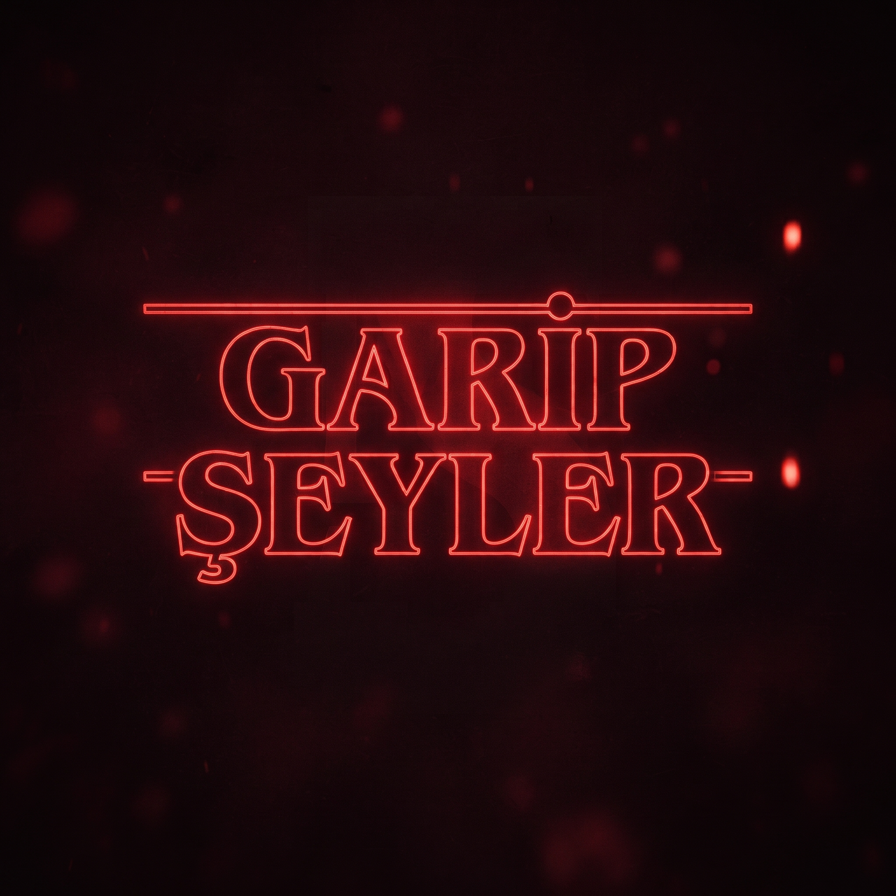

# Garip Şeyler MC — Yol Haritası



Stranger Things temalı Minecraft modu (telif nedeniyle adı **Garip Şeyler MC**).

| Alan | Karar |
|---|---|
| Mod adı / mod id | Garip Şeyler MC / `garipseylermc` |
| Java paketi | `dev.mehbur.garipseyler` |
| Platform | Minecraft Java **26.2** + **Fabric** (Fabric API) |
| Java | Temurin 25 |
| Config | `config/garipseylermc.json` (tüm sayısal değerler burada) |
| Modeller | Yeni moblar (Vecna, Mind Flayer): GeckoLib (26.2 sürümü yoksa vanilla Java model). Yeniden kaplanan vanilla moblar: vanilla Java model + PNG |
| Diller | `tr_tr` + `en_us` |
| Repo | GitHub, **gizli (private)** |
| Test profili | MehburMC Launcher → **Garip Şeyler Test** (Fabric 26.2) |

---

## Faz 0 — Kurulum ve altyapı ✅ (tamamlandı)
- Fabric 26.2 Gradle projesi (Loom, Fabric API, gerekirse GeckoLib).
- Paket yapısı:
  ```
  dev.mehbur.garipseyler
  ├── config      # JSON config yükleme/kaydetme
  ├── dimension   # Ters Dünya / En Derin Dünya mantığı
  ├── entity      # Vecna, Mind Flayer, renderer'lar, AI goal'leri
  ├── block       # Ters Dünya Taşı, sarmaşık
  ├── item        # Telekinezi Eldiveni
  ├── effect      # Vecna Laneti, partikül/ses yardımcıları
  ├── network     # sunucu → istemci paketleri (şimşek, uyarılar)
  ├── mixin       # vanilla davranış değişiklikleri
  └── client      # renderer, gökyüzü/sis, HUD, tuş atamaları
  ```
- Config sistemi (varsayılan değerlerle otomatik oluşturulur).
- Logo → `icon.png` (mod listesi ikonu).
- Git + gizli GitHub reposu, `.gitignore` (hassas bilgi süzgeci).
- Masaüstüne `Garip Şeyler MC.bat` kısayolu: derle → jar'ı test profilinin `mods` klasörüne kopyala.

**Test:** `gradlew build` başarılı, sunucu açılıyor, mod listede görünüyor.

## Faz 1 — Boyut atmosferi ✅ (tamamlandı)
- **Nether → "Ters Dünya" (Upside Down):** tüm biyomlar *görsel olarak* tek kırmızı ton (gökyüzü, sis, su/ambiyans rengi); arazi çeşitliliği korunur. Havada süzülen spor partikülleri, kasvetli ambiyans sesi.
- **End → "En Derin Dünya":** isim, gökyüzü/sis tonu, ambiyans; Ters Dünya'nın da altındaki katman teması.

**Test:** Nether'ın her biyomunda (Crimson, Warped, Soul Sand Valley, Basalt Deltas, Wastes) aynı kırmızı görünüm; End'de yeni atmosfer. Ekran görüntüsüyle kontrol.

## Faz 2 — Kırmızı şimşek ✅ (tamamlandı)
- Ters Dünya'da her **7 sn**'de bir kırmızı şimşek: gökyüzü flaşı + görsel kırmızı yıldırım + ses.
- Sunucu tetikler, istemcilere paket gider (çok oyunculuda senkron). **Hasar yok, yangın yok, mob dönüşümü yok.**

**Test:** 7 sn aralık, hasar/yangın olmadığı, Overworld'de çakmadığı.

## Faz 3 — Mob görünümleri ✅ (tamamlandı; Piglin Brute ve Zoglin de Demodog varyantı oldu)
| Vanilla | Yeni görünüm | Not |
|---|---|---|
| Enderman | **Demogorgon** | Davranış, can, ses mantığı aynı; yeni model/doku/ses |
| Piglin | **Demodog** | normal boy, koyu kırmızı ton |
| Hoglin | **Demodog** | büyük boy, kahverengi-gri ton |
| Zombie Piglin | **Demodog** | normal boy, soluk/çürük yeşilimsi ton |
| Phantom | **Demobat** | Overworld'de uykusuzluk spawn'ı **kapalı**, sadece Ters Dünya'da doğal spawn |

Yalnızca renderer değişir → eski dünyalar bozulmaz.

**Test:** Her mob yeni görünümde; Overworld'de Phantom/Demobat çıkmıyor; Nether'da Demobat spawn oluyor.

## Faz 4 — Ters Dünya sarmaşığı ✅ (tamamlandı)
- Nether portalı yakıldığında çerçevedeki obsidyenlerde **Ters Dünya Sarmaşığı** büyür.
- Çıkış efekti Warden'ın topraktan çıkışı gibi: yükselme animasyonu + blok kırılma partikülleri + `warden.emerge` sesi.
- Etki: sarmaşığın **yarıçapı içindeki** oyuncuların (Nether'da) canı **10 dk**'da bir **1 HP**'ye düşer.
- Düşmeden **30 sn** önce ekranda uyarı + saat sesi (config'den kapatılabilir).

**Test:** Portal yakınca sarmaşık + efekt; yarıçap içi/dışı ayrımı; zamanlayıcı (testte config ile kısaltılarak).

## Faz 5 — Ters Dünya Taşı ve End kuleleri
- Yeni blok **Ters Dünya Taşı**: obsidyen dayanıklılığı (sertlik 50, patlama direnci 1200, elmas+ kazma), dikit (dripstone) tonunda.
- End'deki obsidyen kuleler bu bloktan üretilir (yalnızca **yeni üretilen** End'de).

**Test:** Yeni dünyada kuleler yeni bloktan; kazma/patlama dayanıklılığı obsidyenle aynı.

## Faz 6 — Vecna (boss)
- **Can: 2000**, mor-kırmızı boss bar.
- **Spawn:** her dünyada **sadece 1 kez**, Ters Dünya'da. Başka hiçbir yolla spawn olmaz (spawn egg / ritüel yok). Despawn olmaz.
- **Yetenekler:**
  1. **Lanet** — zamanla can azaltma, doğal can yenilenmesi durur (kemik kırma yerine)
  2. **Havaya kaldırma** — oyuncuyu havada hareketsiz tutar, lanet hızlanır
  3. **Zihin kontrolü** — kamerayı Vecna'ya çevirme, kısa süre ters kontroller, Nausea/Darkness
  4. **Vizyonlar** — saldırı öncesi 4 kez saat "dong"u, kırmızı vignette, sahte mob sesleri
  5. **Telekinezi** — oyuncuyu fırlatma / çekme
  6. **Sarmaşık bağı** — oyuncuyu yerinde sabitleme
  7. **Psişik patlama** — uzaktan mermi saldırısı
  8. **Minyon çağırma** — Demodog/Demobat
  9. **Kısa ışınlanma** — 2. faz (%50 can altı)
  10. **Karşı mekanik** — yakında müzik çalan jukebox veya elde müzik diski → havaya kaldırma/lanete bağışıklık
- **Loot:** yalnızca **%0.1** şansla **Telekinezi Eldiveni**. Başka hiçbir şey düşmez.

**Test:** Tek seferlik spawn bayrağı (dünya kaydında), boss bar, her yeteneğin tek tek tetiklenmesi, loot tablosu.

## Faz 7 — Telekinezi Eldiveni
- **Sol ele (offhand)** takılınca aktif.
- Tuş (varsayılan **V**): bakılan mobu yakala → havada tut, bakışla taşı → tekrar basınca fırlat.
- Bekleme süresi, menzil, fırlatma gücü config'de. Boss'larda (Vecna, Mind Flayer) çalışmaz.

**Test:** Sadece offhand'de çalışıyor; yakala/taşı/fırlat; cooldown.

## Faz 8 — Mind Flayer (Ender Dragon yerine)
- End'de Ender Dragon yerine **Mind Flayer (Taş Form)**: **uçamaz**, yerde savaşır, **1500 can**.
- End kristalleri **iyileştirmez**.
- **Rejenerasyon:** **10 sn** hasar almazsa can dolmaya başlar; 0 → 1500 **60 sn**'de (25 can/sn).
- Saldırılar: yere vurma şok dalgası, taş fırlatma, kükreme (yavaşlatma).
- Öldüğünde vanilla sonu korunur: çıkış portalı, End Gateway, yumurta, XP.

**Test:** Yeni dünyada boss spawn, uçmama, rejenerasyon zamanlaması, ölüm sonrası portal.

## Faz 9 — Cilalama ve teslim
- README: kurulum, özellik listesi, config tablosu, **placeholder dosya tablosu** (hangi PNG/model/ses nereye).
- Varsayımlar listesi.
- (Opsiyonel) Başlık ekranında logo.
- Son tam test turu + GitHub push.

---

## Config (planlanan anahtarlar)
| Anahtar | Varsayılan |
|---|---|
| `redLightningIntervalSeconds` | 7 |
| `vineDrainIntervalMinutes` | 10 |
| `vineDrainTargetHealth` | 1 (HP) |
| `vineEffectRadius` | 32 (blok) |
| `vineWarningSeconds` | 30 |
| `vecnaMaxHealth` | 2000 |
| `vecnaSpawnDelayMinutes` | 15 (Nether'da toplam süre) |
| `vecnaGloveDropChance` | 0.001 |
| `mindFlayerMaxHealth` | 1500 |
| `mindFlayerRegenDelaySeconds` | 10 |
| `mindFlayerFullRegenSeconds` | 60 |
| `gloveRange` / `gloveCooldownSeconds` | 20 / 5 |

## Placeholder dosyaları (Faz 9'da kesinleşir)
```
src/main/resources/assets/garipseylermc/
├── textures/entity/   demogorgon.png, demodog_*.png, demobat.png, vecna.png, mind_flayer.png
├── textures/block/    upside_stone.png, upside_vine.png
├── textures/item/     telekinesis_glove.png
├── geo/  animations/  vecna.geo.json, mind_flayer.geo.json (+ .animation.json)
└── sounds/            *.ogg (+ sounds.json)
```
